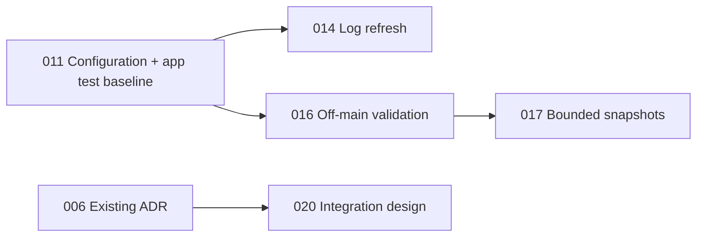

# Implementation Plans

## Product workflow implementation — 2026-11-06

User authorized implementing and verifying all six product recommendations.
[021](021-product-workflows.md) is DONE at `caad1b6` in isolated worktree
`/private/tmp/finder-menu-product-workflows`, branch `codex/product-workflows`,
based on verified v1.0.3 integration `7f501db`. Scope: real-input Live Test,
matching UI, action templates/source selection, verified onboarding,
execution feedback, and portable single-action packages. Final review must map
all six requirements to actual tests, builds and available runtime evidence.
Final [verification record](021-verification.md): reviewer reran **110 tests**,
Debug build and dependency boundary; Settings GUI smoke tests passed. Live Finder
permission/notification delivery remains outside these scoped runtime checks.

## Current planning batch — 2026-11-06

Plans **011–020** were written against commit **`9898180`** after the maintainer
selected all eight vetted findings and both direction options. Execution completed in isolated branch `codex/release-v1.0.3` (worktree
`/tmp/finder-menu-all-integrated`); see the verification record below. The historical 001–010 plans and verification records below
remain intact; no completed plan is being reopened or duplicated.

Current audit verification: `./Scripts/test.sh` passed **66 tests in 10 suites**;
`npm --prefix web run lint` passed. App builds, web builds, real Finder/GUI behavior,
release signing/notarization and live release destinations were not verified in
this audit. Future executor commands in the plans are requirements, not claimed results.

### Recommended order and status

| Plan | Title | Priority | Effort | Depends on | Status |
|------|-------|----------|--------|------------|--------|
| [011](011-preserve-invalid-configuration.md) | Preserve invalid configuration; retain application-state regression tests | P1 | M | — | DONE |
| [012](012-validate-published-manifest.md) | Validate the website's published manifest through the real decoder | P1 | S | — | DONE |
| [013](013-strict-dmg-release.md) | Fail production DMG packaging when verification fails | P1 | S | — | DONE |
| [014](014-refresh-settings-logs.md) | Refresh logs on inspection and application activation | P2 | S | 011 | DONE |
| [015](015-centralize-release-links.md) | Centralize latest-release links and remove stale versions | P2 | S | — | DONE |
| [016](016-validate-requests-off-main.md) | Move filesystem validation off the Host main actor | P2 | M | 011 | DONE |
| [017](017-bound-snapshot-transport.md) | Bound UTF-8 chunks and incomplete snapshot assemblies | P2 | M | 016 when both selected | DONE |
| [018](018-verify-web-toolchain.md) | Align Node prerequisites and add web CI | P2 | S | — | DONE |
| [019](019-design-live-test-inputs.md) | Design selectable test inputs and execution preview | P3 | M | — (design only) | DONE |
| [020](020-design-authenticated-ipc-integration.md) | Specify production-shaped authenticated IPC integration gates | P3 | L | 006 already DONE (design only) | DONE |

Status values: TODO | IN PROGRESS | DONE | BLOCKED (reason) | REJECTED (rationale).
For 019/020, DONE means the **design/experiment specification** is complete; it
must never mean the proposed feature or authenticated transport has shipped.

### Execution verification — 2026-11-06

Release published: [v1.0.3](https://github.com/tdawn0-0/FinderActions/releases/tag/v1.0.3),
build 4, tag commit `201ace1`. ZIP/DMG and SHA-256 files uploaded; Apple notarization
Accepted for both app and DMG, stapler and Gatekeeper verified. Website deployed
successfully. Follow-up main `7f501db` fixes test scheduling races, isolates SwiftPM
CI scratch directories, and uses identical explicit delegate initializer arguments
to avoid the Xcode 16.4 compiler crash. Released tag/assets were not replaced.
Final [remote CI](https://github.com/tdawn0-0/FinderActions/actions/runs/42229309104)
passed macOS (including Xcode 16.4 app build) and web jobs.

All ten plans completed and reviewed. Final implementation base `d52c5c5` is
v1.0.3 build 4. Combined suite: **76 Core tests + 12 application tests = 88 passed**.
Reviewer independently reran the combined Swift suite, 14 DMG helper cases plus
failed-release orchestration, and both design contract checkers. Website clean
npm install, lint, release-link guard and production build passed. Universal Debug
build and Host-no-SwiftUI check passed in executor runs; signed release verification
is recorded separately below when complete. Real GUI/Finder behavior was not driven.

011 recovery, migration, reset and debounce tests run against actual app sources
using isolated files/preferences. Review found and corrected an independent OpenWith
preference fallback during invalid-manifest startup. 016 tests prove MainActor
responsiveness and deduplication; 017 tests cover Unicode, expiry and buffer bounds.
019 is a finished Live Test design; 020 is a finished integration specification with
42 NOT_RUN gates. Its adoption-readiness check correctly fails; production IPC
remains distributed notifications and must not be described as authenticated.

Source changes and release metadata live in the isolated integration branch; the
original main checkout was not overwritten during execution. Build-generated Xcode
project worktree-name churn was removed. Deployment/signing details are not stored
as credential values in this index.

### Dependencies and parallel work

- 011 introduces isolated `FinderActionsAppTests`; 014 and 016 reuse it. Keep
  actual application sources under test and do not touch production preferences.
- 017 follows 016 to avoid competing edits to `IPCServer.swift`; there is no
  algorithmic dependency on off-main validation. Re-read the combined file.
- 012, 013 and 015 can start independently of 011. 018 can also start independently,
  but adding 015's optional CI guard is easiest after 015 exists.
- Serialize integrations touching `Package.swift` (011/012/014/016),
  `.github/workflows/ci.yml` (011/013/018), `web/package.json` (015/018), and both
  release guides (013/018); preserve each plan's checks rather than replacing them.
- 019/020 deliver only plans/ artifacts. A later implementation of 019 should build
  on configuration/log improvements. Later IPC migration must preserve 016/017's
  validation/transport lessons or replace them with equivalent tested guarantees.
- Plan drift checks must distinguish declared prerequisite changes from unexplained
  drift; record the actual baseline before proceeding. Never overwrite user edits.

### Current batch boundaries and considered findings

- Existing distributed-notification authentication limitations are already recorded
  in ADR 0001 and plan 006. They are not a new duplicate defect; 020 specifies the
  remaining integration experiment, without claiming maintainer adoption of option A.
- The Settings test-coverage gap is folded into 011 rather than a separate broad
  testing/architecture refactor. The current Core suite does not exercise AppState.
- `npm audit` reported high-severity packages, but runtime/build reachability was not
  established. No blind dependency upgrade plan or claim of resolved advisories.
- Minor clipboard-success timing and locale-default observations are deferred; lower
  leverage than the selected data integrity, release and execution-path work.
- Core/runtime and Settings hotspots, website examples/downloads, release tooling,
  dependency engine declarations and CI were inspected. This was not an exhaustive
  audit of every UI/localization string or a live security/performance assessment.
- Real Finder/AppKit behavior, minimum-OS runs, signing/DMG execution, transport
  delivery limits, live website rendering/accessibility and advisory exploitability
  remain unverified. Existing 001–010 GUI limitations are preserved below.

---

## Historical batch — 2026-10-02

Generated by the improve skill on 2026-10-02 against commit `2e59370`. Execute in
the order below unless dependencies say otherwise. Each executor: read the plan
fully before starting, honor its STOP conditions, and update your row when done.

Verification commands used throughout: `./Scripts/test.sh` (SwiftPM tests, 35
passing at planning time) and `./Scripts/dev.sh` (xcodegen + Debug build + Host
SwiftUI-boundary check; it regenerates `FinderActions.xcodeproj/project.pbxproj`).

## Historical execution order & status (001–010)

| Plan | Title | Priority | Effort | Depends on | Status |
|------|-------|----------|--------|------------|--------|
| [001](001-safe-action-type-picker.md) | Action type picker can no longer delete actions or create always-failing ones | P1 | S | — | DONE |
| [003](003-process-runner-off-main.md) | Actions run off the Host main thread through a deadlock-free, tested ProcessRunner | P1 | M | — | DONE |
| [005](005-validate-execute-requests.md) | Host re-validates every execute request before running it | P1 | S | 003 | DONE |
| [002](002-debounce-manifest-saves.md) | Settings edits are debounced instead of saving + broadcasting per keystroke | P2 | S | 001 | DONE |
| [004](004-ci-and-shell-action-integration-tests.md) | CI runs tests + app build; shell-action path has end-to-end tests | P2 | S | 003 | DONE |
| [007](007-log-script-output.md) | Execution logs keep the tail of stderr, as the docs promise | P2 | S | 003 | DONE |
| [006](006-spike-authenticated-ipc.md) | (spike) Decide and prototype an authenticated Extension → Host channel | P2 | M | 005 | DONE |
| [008](008-status-menu-action-count.md) | Menu bar "N actions ready" count matches Finder | P3 | S | — | DONE |
| [009](009-remove-dead-snapshot-fallbacks.md) | Remove unreachable App Group / Host-file snapshot fallbacks; fix docs | P3 | S | — | DONE |
| [010](010-shared-configuration-bootstrap.md) | Host and Settings share one configuration bootstrap; dead state removed | P3 | M | 002, 007 | DONE |

Status values: TODO | IN PROGRESS | DONE | BLOCKED (with one-line reason) | REJECTED (with one-line rationale)

Plan 001 verified on 2026-10-02: Core change + regression test in `36a77a9`,
Settings picker change in `ec8a142`. Final `./Scripts/test.sh`: 36 tests in
6 suites passed; `./Scripts/dev.sh`: build and dependency boundary check passed.
No Terminal picker tag remains. Manual GUI verification was attempted twice,
but Computer Use returned "native pipe closed before response"; runtime menu
and legacy Built-in selection remain unverified. The pre-existing untracked
plan files were not added to the implementation commits.

First integration batch verified on 2026-10-02: 002 (`93c515e`) includes
an isolated actual-AppState harness verifying batching, latest edit, cancellation,
and flush; 003 (`7c7b81a`, `3eb6583`) has nine scoped tests (the seven planned
cases plus ignored-SIGTERM escalation and bounded stderr suffix retention);
008 (`11787da`) and 009 (`05e2b66`) have successful isolated Debug builds.
The combined Core suite passed 45 tests in 7 suites. Finder/GUI checks remain
unverified; no user configuration was modified or Finder restarted.

Second integration batch verified on 2026-10-02: 004 (`8cc50cc`, `ec9677b`)
adds two real zsh path/environment integration tests and validated macOS CI;
005 (`4c6b82a`) adds 14 request-validation tests including background selection
consistency; 007 (`af7ba3f`) adds five OutputTail tests and an actual old/new
ExecLogEntry/ExecLogStore JSONL compatibility harness. The reviewer reran the
actual IPCServer responsiveness and log-compatibility harnesses successfully.
The combined Core suite passed 66 tests in 10 suites, and the combined Debug
build and dependency check passed. An independent read-only integration review
found no actionable correctness issue. CI was not run remotely (no push).

Final integration verified on 2026-10-02: 010 (`19d9f3d`, `f7e6e3c`) shares
configuration and removes dead state. The reviewer reran its actual Host/Settings
source harness covering fresh/existing configuration, migration, script priority,
755 permissions, restoration/preservation, reset and pending edits. User data and
preferences were not changed. Host/Settings source lengths are 68/308 lines, and
the project diff contains only six SharedConfiguration additions.
Final `./Scripts/test.sh`: 66 tests in 10 suites passed; `./Scripts/dev.sh`:
Debug build and dependency boundary passed; `swift build`: all package products
built; workflow YAML and static gates passed. GUI/Finder checks remain unverified
because Computer Use could not open the Debug helper (native pipe closed).

006's ADR is `docs/adr/0001-authenticated-host-ipc.md` (`397575a`), seven sections,
with a recommendation awaiting maintainer sign-off. Recoverable prototype
`083ccef` exists only on `spike/006-xpc-ipc` and was never merged. Its controlled
XPC results cover matching/mismatching peers and sandbox lookup entitlement.
The reviewer independently reran the prototype matrix and confirmed the same
results, the outgoing-data-before-rejected-reply caveat, and launchd job cleanup.
Real FinderSync, release-signing/group access, SMAppService lifecycle, macOS 15
and production memory remain future integration gates, as allowed by this spike.
The production transport remains distributed notifications with plan 005 checks.
Plan 009's documentation search excludes the new ADR's intentional discussion of
future App Groups; its three edited current-behavior documents have no stale
fallback claims. Pre-existing untracked plans were kept out of source commits.

Follow-up Computer Use GUI verification on 2026-10-02: resetting the Node kernel
restored successful Finder AX reads, screenshots, Go to Folder navigation and
opening the Debug helper through Finder. Settings reads by full path/display
name still returned "Sky Computer Use native pipe closed before response";
its bundle ID was ambiguous across installed and built copies. Debug Host reads
returned error -10005 (timeoutReached). A temporary copy under ignored
`build/GUIValidation/FinderActions UI Verification.app`, with unique bundle ID
and LSUIElement disabled but the same Debug binaries, also could not be read.
No inspector edits, action executions, log edits or preference changes were
performed. All four planned GUI checks remain unverified; no source code was
changed during this follow-up.

## Historical dependency notes (001–010)

- 002 after 001: both edit `SettingsRootView.swift` around the action inspector (picker at ~432, binding at ~212).
- 004, 005, 007 after 003: 004's integration tests use `ProcessRunner`; 005 inserts validation into the rewritten `IPCServer.processJSON`; 007 extends `IPCServer.finish`, which 003 creates.
- 006 after 005: the spike assumes the short-term validation is in place.
- 010 last among Settings work: 002 and 007 both edit `AppState.swift`.
- 008 and 009 are independent and can go any time (009: re-check if 006 adopts App Groups).

## Findings considered and rejected

- Split `SettingsRootView.swift` (1,389 lines): mechanical, low payoff now; revisit when a feature needs to change several of its views.
- `ExecLogStore` cross-process read-modify-write race (Host + Settings test runs append to the same `exec.jsonl`): low frequency, loses at most one log line.
- Notarization credential handling: correctly uses a `notarytool` keychain profile; `.release.env` is gitignored and was never committed.
- Housekeeping (not plan-worthy): untracked arm64 Mach-O `main` at repo root (delete or ignore); `web/worker/index.ts` still serves the template `/api/` route returning `{"name":"Cloudflare"}`.

## Direction options (not planned; ask for a design/spike plan if wanted)

- Implement built-in actions (`cut-add` / `cut-move-here` etc. are named in `Action.swift:247`) — Finder cut/move is a known gap.
- Drop-in scripts with header metadata (`# @name`, `# @showWhen`) so a script file alone registers an action — matches the README pitch "edit scripts as files, git them, share them".
- Menu-bar "Run on Finder selection" — anticipated in `docs/troubleshooting.md` and `SnapshotBuilder.filter`'s doc comment; also a fallback when the extension isn't registered.

## Historical audit limits (2026-10-02)

Web landing-page React components, release/DMG scripts beyond credential handling, localization catalogs, `npm audit`, and Settings view code outside the cited regions.
